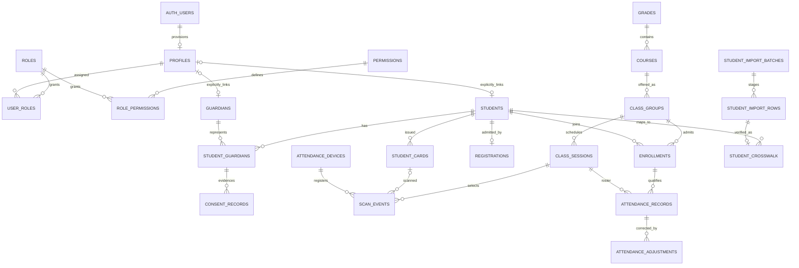

# Architecture decision record · foundation

**Primary specification:** [Master Technical Architecture & Integration Specification V2.0](spec/master-architecture-v2.txt), preserved byte-for-byte from the supplied attachment. SHA-256: `d749d4071669340301400d1a43c1e0a2948773e4645a6857ce77c6091909fc47`. An implementation note cannot silently supersede the proposal. Record material changes and obtain academy/CEYTEQ approval. `academy-core` is a private working identifier, not a brand or domain recommendation.

## What is being built

One academy's digital education and management platform for a Sinhala-medium science educator, grades 6–11. Sections 1–6 and 21–22 cover academy ownership, public website, SEO blog/social feed, registration, accessible low-bandwidth student/guardian/teacher portals and admin operations. Sections 7–16 and 23–25 define data, security, integrations, cards, attendance and contracts. Sections 17–20 and 26–28 require gated rollout, incumbent reconciliation and handover. The revised sequence puts admission, cards and supervised attendance **before** broader LMS and external automation. No public surface or frontend is part of this implementation.

The academy owns its student relationships, brand, domain and assets subject to agreement; CEYTEQ is the technology partner. IP, controller/processor duties, cloud tenancy, billing/settlement, support, exit rights, source handover and data residency are unresolved. Do not infer a tenancy from a login. No `tenant_id`: one institution per approved project. Serving a second institution requires a reviewed tenancy design first.

## System boundary

```text
Verified Supabase email session (+ TOTP AAL2 for administrators)
  → /api/v1 TypeScript router: bearer only, validation, origin + size + rate checks
  → Auth /user verifies the session; user JWT is forwarded unchanged, never elevated
  → PostgREST academy_api (only exposed schema; named, typed RPCs)
      → invoker reads → academy tables + RLS + column grants
      → narrow definer commands → permission/scope/consent/constraints + audit in one tx
  → resource access → same-user Storage policy → short-lived private signed URL

Provider callbacks → reserved endpoint → 503 (no acknowledgement, storage or processing)
Future: verify raw event → durable dedupe + enqueue → bounded retry/dead letter → review
```

Modular monolith, not 18 separately deployed services. `src/modules` holds active HTTP contracts; PostgreSQL owns atomic business transitions, including when a caller uses RPC directly. `src/platform` handles transport and authentication. The server is ordinary TypeScript/Node with a Vercel function adapter; no Next.js UI, Edge runtime or service-role proxy is required. `src/integrations` is deliberately incapable of network I/O. Foundation seeds are role/permission/grade vocabulary only.

## Module-to-data and dependency map

The table distinguishes **implemented behavior** from **storage design**. A table is not a working provider integration. See the [data dictionary](data-dictionary.md) for columns/keys of every table.

| # | Bounded module; dependencies | Foundation now | Subsequent gate |
|---|---|---|---|
| 1 | Identity & access; Supabase Auth | `profiles`, `roles`, `permissions`, `user_roles`, `role_permissions`, `write_quotas`; verified bearer, role matrix, MFA gate | Ownership, approved account provisioning, recovery drills |
| 2 | Students & guardians; identity for portal access | `students`, `guardians`, `student_guardians`; many-to-many, verified guardian account **and** per-child verification | Custody evidence and reviewed identity linking, never phone matching |
| 3 | Registration & enrolment; guardian consent + academic catalogue | `registrations`, `enrollments`; atomic admission and additional enrolment; `student_import_batches`, `student_import_rows`, `student_crosswalk` | Incumbent rights, mapping, retained history and reconciliation |
| 4 | Cards & attendance; 2, 3, 5, authorized operators | `student_cards`, `card_templates`, `card_print_jobs`, `attendance_devices`, `scan_events`, `attendance_records`, `attendance_adjustments`, `attendance_notification_jobs`; issuance/rotation, scans, overrides and reports | Print design/hardware, attendance rules/pilot; offline queue and notices not enabled |
| 5 | Courses, classes & sessions; grades/staff identity | `grades`, `courses`, `class_groups`, `class_sessions`; admin provisioning and scoped schedules | Confirm real timetables, thresholds and teacher assignments |
| 6 | Digital library; media scan + family/enrolment | `library_resources`, `resource_access_rules`, `resource_entitlements`, `resource_views`, `resource_downloads`; entitled reads and private signing | Upload scanner, retention and hosted file tests before ingest |
| 7 | LMS; classes + library, approved live provider | `video_lessons`, `live_sessions`, `lesson_recordings`, `assignments`, `submissions`, `assessments`, `assessment_attempts` | Live/recording consent, costs, grading and assignment APIs |
| 8 | CMS & blog; staff roles + cleared media | `pages`, `posts`, `post_categories`, `tags`, `post_tags`, `media_assets`, `content_revisions`, `events`, `testimonials`; draft posts + first revision, scoped reads | Brand, editorial approval, revisions/publishing UI and licensed content |
| 9 | CRM & leads; consent + staff | `contacts`, `leads`, `lead_sources`, `lead_activities`, `lead_attributions`, `form_submissions`; staff creation, source, stage and follow-up; lead may later link to student | Public enquiry anti-spam and staff alert; authorized Meta retrieval |
| 10 | Social; CMS + provider registry/jobs | `social_accounts`, `social_posts`, `social_post_targets`, `social_sync_events`; canonical post → approved targets | Each account OAuth/review, quotas, rights/attribution |
| 11 | Advertising; social accounts + CRM attribution | `ad_accounts`, `ad_campaigns`, `ad_metrics`; authorized account → campaigns → daily insights | Spend cap, written change approval; no campaigns |
| 12 | AI & messaging; approved knowledge + verified recipient | `chatbot_configs`, `knowledge_documents`, `conversations`, `messages`, `handoff_requests`, `message_templates`, `outbound_messages`, `message_deliveries`, `communication_preferences`, `notifications`; only in-app reads | Retrieval, citations, escalation, retention, moderation and budget; no bot or sends |
| 13 | Payments; merchant + guardian/student relationship | `products`, `prices`, `orders`, `order_items`, `invoices`, `payments`, `refunds`, `payment_webhook_events`; integer minor units and scoped external IDs | Hosted checkout, signed settlement, replay/out-of-order tests; never store PAN/CVV |
| 14 | SMS; 12 + approved local gateway | Shares channel, opt-in, template, delivery and attendance-job records | Sender ID, callback authenticity, costs and opt-out |
| 15 | WhatsApp Business; 12 + business onboarding | Shares channel/message records, WABA/phone registry and webhook boundary | Template/locale approval, opt-in, conversation window and human handoff |
| 16 | Feedback & analytics; privacy and consent | `feedback`, `testimonials`, `analytics_events` (aggregates only); ad/lead attribution separate | Review/redaction, testimonial releases, consented GA4/Search Console |
| 17 | Finance & operations; verified payment events | `settlements`, `payment_reconciliations`, `expenses`; matched provider/account refs and discrepancies | Currency/fee rules, refunds, reconciler and settlement sign-off |
| 18 | Audit & settings; all privileged changes | `audit_logs`, `consent_records`, `system_settings`, `integration_connections`, `integration_sync_jobs`, `webhook_events`; append-only evidence, per-account dedupe, no token values | Retention/deletion, managed queue, monitoring, incident/restore drills |

## Core relational model



`attendance_records` is V2's canonical attendance relation (not a second unsynchronized `attendance` table). Surrogate IDs are UUIDs; joins use composite keys, and the public-facing student code is distinct from any provider ID or QR secret. Student/course grade is verified on enrolment. Enrollment validity is an inclusive **Asia/Colombo calendar date** interval; session times are `timestamptz`. One enrollment per student per group; create distinct term groups rather than overwriting historical memberships. Scan and adjustment history are independent of the current attendance status. Reports distinguish **unmarked** from absent.

Other invariants: one active card per student (issue and rotate under a row lock); unique request ID per immutable scan; one attendance per student/session with composite session/group and student/group FKs. Per-account external IDs, verified-event digests and separate job state avoid collisions and mutating payment evidence. An order can have multiple payments. A lead is not a portal identity; a CRM phone number can never grant access. Advanced domains default to no client table privileges or write policies.
